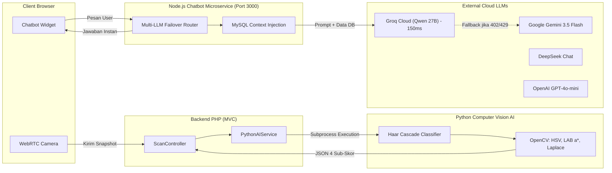

# 🌸 SkinCheck (APSkincek) — AI-Powered Skin Health Monitoring & Skincare Assistant

[](https://www.php.net/)
[](https://nodejs.org/)
[](https://www.python.org/)
[](https://opencv.org/)
[](https://www.mysql.com/)
[](https://github.com/aditiyawichal-sys/APSkincek/actions)
[](#lisensi)

---

## 👥 1. IDENTITAS ANGGOTA KELOMPOK

Dokumen dan repositori proyek ini disusun untuk memenuhi persyaratan **Ujian Akhir Semester (UAS) Mata Kuliah Rekayasa Perangkat Lunak (RPL)**:

| Parameter | Keterangan |
| :--- | :--- |
| **Nama Mahasiswa** | **Wichal Aditiya Purnama** |
| **Nomor Induk Mahasiswa (NIM)** | **41257167** |
| **Nama Kelompok** | **Cangkol Perangkat Lunak** |
| **Peran / Kontribusi** | Fullstack Architecture, Backend PHP MVC, Node.js AI Microservice, Python CV Integration & CI/CD Pipeline |
| **Anggota Kelompok Lain** | `[Placeholder: Diisi nama anggota lain jika ada / Mandiri]` |
| **Mata Kuliah** | Rekayasa Perangkat Lunak (RPL) |
| **Program Studi / Fakultas** | `[Placeholder: Teknik Informatika / Ilmu Komputer]` |
| **Perguruan Tinggi** | `[Placeholder: Nama Universitas / Perguruan Tinggi]` |
| **Tahun Akademik** | 2026 / 2027 |

---

## 📌 2. TEMA DAN TOPIK KELOMPOK

* **Tema Utama:** *HealthTech & Artificial Intelligence in Software Engineering*
* **Topik Spesifik:**  
  **"Rancang Bangun Platform Pemeriksaan Kesehatan Kulit Wajah, Evaluasi Cakupan Tabir Surya (Sunscreen), dan Asisten Rekomendasi Skincare Berbasis Computer Vision dan Multi-LLM Auto-Failover Menggunakan Pola Arsitektur MVC."**

---

## 📖 3. DESKRIPSI APLIKASI

### 3.1 Penjelasan Umum
**SkinCheck (APSkincek)** adalah platform perangkat lunak berbasis web (*Web-Based HealthTech Application*) yang menggabungkan kemampuan komputasi visual (*Computer Vision AI*) dan pemrosesan bahasa alami (*Large Language Models / LLM*) untuk membantu masyarakat memantau kondisi kesehatan kulit wajah secara mandiri, objektif, dan non-invasif langsung dari peramban web (*browser*).

### 3.2 Tujuan Pembuatan Aplikasi
1. **Aksesibilitas Kesehatan Kulit:** Menyediakan media evaluasi kondisi kulit wajah harian tanpa memerlukan perangkat keras klinis berbiaya mahal.
2. **Edukasi Tabir Surya (*Sunscreen Awareness*):** Membantu pengguna memvisualisasikan ketepatan dan pemerataan pengaplikasian tabir surya pada area wajah demi mencegah risiko kerusakan sinar ultraviolet (UV).
3. **Personalisasi Perawatan yang Ilmiah:** Menyajikan rekomendasi produk perawatan kulit (*skincare routine*) yang terkunci ketat pada katalog produk resmi di basis data agar terhindar dari salah beli produk (*skincare mismatch*).
4. **Penerapan Standar RPL Modern:** Mengimplementasikan prinsip rekayasa perangkat lunak yang andal, mulai dari arsitektur Model-View-Controller (MVC), microservice AI, sistem pengujian otomatis (*Unit Testing*), hingga integrasi berkelanjutan (*CI/CD GitHub Actions*).

### 3.3 Permasalahan yang Ingin Diselesaikan (*Problem Statement*)
* **Evaluasi Kulit yang Subjektif & Mahal:** Sebagian besar masyarakat kesulitan mengetahui secara pasti apakah kondisi jerawat, kemerahan, atau pori-pori mereka membaik tanpa pergi ke klinik kecantikan.
* **Aplikasi Tabir Surya Tidak Merata (*Uneven Sunscreen Application*):** Mayoritas kerusakan kulit akibat radiasi UV timbul karena pengguna sering melewatkan area rentan (seperti cuping hidung dan bawah mata) saat memakai tabir surya.
* **Ketergantungan Tren Medsos yang Memicu *Breakout*:** Maraknya promosi viral media sosial kerap mendorong konsumen membeli produk yang tidak sesuai dengan jenis dan kebutuhan biologis kulitnya.
* **Chatbot AI Konvensional yang Sering Berhalusinasi:** Asisten AI generik di pasaran rentan mengarang produk fiktif atau memberikan anjuran obat resep keras yang berisiko bagi kesehatan pengguna.

---

## 🚀 4. FITUR UTAMA APLIKASI

Sistem SkinCheck dilengkapi dengan fitur komprehensif yang melayani dua kelompok aktor (*Customer* dan *Super Administrator*):

| No | Modul Fitur | Penjelasan Fungsi |
| :---: | :--- | :--- |
| **1** | **Autentikasi & WhatsApp OTP** | Registrasi akun baru, login, dan reset sesi yang diverifikasi langsung dengan kode OTP 6 digit melalui Fonnte WhatsApp API Gateway serta enkripsi kata sandi menggunakan `bcrypt`. |
| **2** | **Onboarding Profil Kulit** | Kuesioner interaktif pengguna baru untuk memetakan jenis kulit (Berminyak, Kering, Kombinasi, Normal, Sensitif) dan keluhan utama (Jerawat, Kemerahan, Pori, Hiperpigmentasi). |
| **3** | **Customer Dashboard** | Halaman utama pengguna yang menyajikan kartu metrik *Overall Health Score (0-100)* pemindaian terakhir, tombol aksi cepat, dan rekomendasi rutinitas skincare pagi (*AM*) dan malam (*PM*). |
| **4** | **Face Scan Kamera WebRTC** | Pemanfaatan HTML5 Canvas & WebRTC API dengan siluet oval panduan wajah dan animasi sinar laser pemindai (*scanning beam*) beresolusi tinggi. |
| **5** | **Analisis Kulit AI (Computer Vision)** | Pemindaian citra wajah otomatis untuk mengukur 4 parameter: skor jerawat (*acne*), indeks eritema (*redness*), kehalusan tekstur pori, dan hiperpigmentasi. |
| **6** | **Pemeriksaan Cakupan Sunscreen** | Estimasi persentase ketercakupan tabir surya (*0-100%*) dan penyajian koordinat *heatmap* visual untuk menandai area wajah yang terlewat (*missed areas*). |
| **7** | **Rekomendasi Terikat Katalog Resmi** | Algoritma pencocokan skor kondisi kulit yang hanya merekomendasikan produk aktif di basis data (*anti-halusinasi / zero hallucination*). |
| **8** | **Chatbot Asisten Pintar Real-Time** | Layanan percakapan interaktif berbasis Node.js yang membaca konteks database MySQL secara *live* dan menerapkan aturan privasi jawaban bertahap. |
| **9** | **Panel Super Administrator** | Dashboard manajemen metrik operasional (total user, total scan), CRUD master produk skincare, artikel edukasi, dan audit rekam aktivitas (*security logs*). |
| **10**| **Live Multi-AI Failover Config** | Pengaturan kunci utama (*primary*) dan kunci cadangan (*backup*) API AI dari antarmuka admin lengkap dengan pengujian latensi langsung tanpa restart server. |

---

## 🧠 5. FITUR ARTIFICIAL INTELLIGENCE (AI)

Aplikasi ini mengintegrasikan dua cabang kecerdasan buatan terdepan:



### 5.1 Computer Vision AI (Analisis Wajah & Sunscreen)
* **Teknologi:** Python 3.10+, OpenCV (`cv2`), NumPy, Haar Feature-based Cascade Classifier.
* **Fungsi & Cara Kerja:**
  1. **Deteksi Wajah:** Menemukan lokasi wajah pada citra input melalui model Haar Cascade frontalface XML. Jika wajah tidak proporsional, sistem mengisolasi ROI (*Region of Interest*) bagian tengah.
  2. **Deteksi Jerawat & Lesi:** Segmentasi warna berbasis ambang batas adaptif (*adaptive thresholding*) pada ruang warna HSV dan YCrCb untuk mendeteksi papula dan blemish.
  3. **Deteksi Kemerahan (Eritema):** Mengekstraksi kromatisitas kanal $a^*$ pada ruang warna CIELAB ($L^*a^*b^*$) untuk mengukur derajat inflamasi pembuluh darah mikro di kulit.
  4. **Analisis Tekstur & Pori:** Menghitung operator varians Laplacian ($\nabla^2 f$) untuk membedakan kehalusan vs kekasaran permukaan stratum korneum.
  5. **Analisis Cakupan Tabir Surya:** Memproses citra untuk memetakan deviasi saturasi pantulan cahaya tabir surya dan memproyeksikan koordinat area yang belum terlapisi (*missed areas*).

### 5.2 LLM AI Chatbot & Multi-AI Auto-Failover
* **Teknologi:** Node.js Express microservice (port 3000), `groq-sdk`, `@google/generative-ai`, MySQL2 Promise Pool.
* **Fungsi & Cara Kerja:**
  1. **Integrasi Konteks Basis Data (*Database RAG*):** Setiap pesan pengguna diperkaya secara dinamis dengan ringkasan status akun, riwayat pemindaian terakhir, katalog produk aktif, dan agregasi data sistem langsung dari MySQL.
  2. **Multi-LLM Auto-Failover (Uptime 99.9%):** Router AI cerdas memprioritaskan kunci utama (Groq Cloud latency ~150–300 ms). Jika terjadi kesalahan limit kuota atau status HTTP 401, 402 (*Insufficient Balance*), atau 429 (*Rate Limit*), sistem otomatis mengalihkan *payload* ke kunci cadangan (Google Gemini 3.5 Flash, DeepSeek, atau OpenAI) dalam waktu **< 300 ms** tanpa gangguan pada pengguna.
  3. **Guardrails Privasi & Medis:** 
     * *Aturan Privasi Bertahap:* Jika ditanya *"ada berapa customer?"*, sistem hanya menjawab total jumlahnya. Hanya jika ditanya *"siapa saja customer nya?"*, sistem merinci daftar nama secara sopan tanpa tanda kurung.
     * *Medical Safety:* Memblokir anjuran obat resep keras (misal: Isotretinoin oral) dan memberikan rujukan darurat (*Red Flag Routing*) ke Dokter Spesialis Kulit (Sp.KK / Sp.DVE) jika mendeteksi keluhan berbahaya.

---

## 🎥 6. TAUTAN VIDEO DEMONSTRASI YOUTUBE

Dokumentasi video demonstrasi sistem, pengujian unit test lokal, dan implementasi CI/CD GitHub Actions dapat disaksikan secara daring melalui tautan YouTube berikut:

* 🔗 **Tonton Video Demonstrasi (YouTube):**  
  [](https://youtu.be/IAnv29EBfus)  
  👉 **[https://youtu.be/IAnv29EBfus](https://youtu.be/IAnv29EBfus)**  
  *(Tautan Alternatif: [https://www.youtube.com/watch?v=IAnv29EBfus](https://www.youtube.com/watch?v=IAnv29EBfus))*

---

## 🛠️ 7. PANDUAN INSTALASI & MENJALANKAN APLIKASI

### 7.1 Persyaratan Perangkat & Software (*Prerequisites*)
* **Sistem Operasi:** Windows 10/11, Linux, atau macOS.
* **Web Server & Database:** [XAMPP](https://www.apachefriends.org/) (Apache 2.4+ dan MySQL 10.4 / MariaDB dengan ekstensi PHP PDO, SQLite, cURL, OpenSSL).
* **PHP Runtime:** Versi **8.2+**.
* **Node.js Runtime:** Versi **18.x / 20.x+** ([Unduh Node.js](https://nodejs.org/)).
* **Python Runtime:** Versi **3.10+** dengan package manager `pip` ([Unduh Python](https://www.python.org/)).
* **Peramban Web:** Google Chrome / Edge versi terbaru.

---

### 7.2 Langkah 1: Kloning Repositori
Buka terminal (Command Prompt / PowerShell / Git Bash) di direktori web server XAMPP (`htdocs`):
```bash
cd C:\xampp\htdocs
git clone https://github.com/aditiyawichal-sys/APSkincek.git
cd APSkincek
```

---

### 7.3 Langkah 2: Setup Basis Data MySQL
1. Pastikan modul **Apache** dan **MySQL** pada XAMPP Control Panel telah berstatus **Running**.
2. Buka antarmuka **phpMyAdmin** melalui browser: `http://localhost/phpmyadmin/`.
3. Buat database baru dengan nama:
   ```sql
   CREATE DATABASE skincheck_db;
   ```
4. Buka tab **Import**, pilih file struktur tabel:  
   📂 `SkinCheck/database/schema.sql` lalu klik **Import**.
5. (Opsional namun disarankan) Import file data awal:  
   📂 `SkinCheck/database/seed.sql` untuk mengisi akun admin default, katalog produk awal, dan artikel edukasi.

---

### 7.4 Langkah 3: Setup Dependencies Python (Computer Vision)
Buka terminal dan install pustaka OpenCV serta NumPy:
```bash
cd C:\xampp\htdocs\APSkincek\SkinCheck\python_ai
pip install opencv-python numpy
```

---

### 7.5 Langkah 4: Setup Dependencies Node.js (Chatbot Server)
Buka terminal baru dan install dependensi npm chatbot:
```bash
cd C:\xampp\htdocs\APSkincek\SkinCheck\nodejs-chatbot
npm install
```

---

### 7.6 Langkah 5: Konfigurasi Kunci Lingkungan (*Environment Variables*)
Aplikasi telah dilengkapi berkas konfigurasi template yang aman dari kebocoran data rahasia (*secret protection*):

1. **Konfigurasi AI LLM:**  
   Salin `SkinCheck/config/ai_config.example.json` menjadi `SkinCheck/config/ai_config.json`:
   ```bash
   copy SkinCheck\config\ai_config.example.json SkinCheck\config\ai_config.json
   ```
   *Buka file tersebut dan masukkan API Key Groq atau Google Gemini Anda (atau atur langsung melalui UI Admin).*

2. **Konfigurasi WhatsApp OTP Fonnte:**  
   Salin `SkinCheck/config/fonnte_config.example.json` menjadi `SkinCheck/config/fonnte_config.json`:
   ```bash
   copy SkinCheck\config\fonnte_config.example.json SkinCheck\config\fonnte_config.json
   ```
   *Buka file tersebut dan masukkan Token Akun [Fonnte](https://fonnte.com/) Anda.*

3. **Konfigurasi API PHP:**  
   Salin `SkinCheck/config/api.example.php` menjadi `SkinCheck/config/api.php`:
   ```bash
   copy SkinCheck\config\api.example.php SkinCheck\config\api.php
   ```

---

### 7.7 Langkah 6: Menjalankan Aplikasi

#### Cara 1: Sekali Klik (Otomatis)
Cukup klik ganda berkas batch di folder utama:
👉 **`start_all.bat`**
Skrip akan otomatis memastikan server Apache, MySQL, dan Node.js Chatbot berjalan di latar belakang, lalu membuka browser ke alamat aplikasi.

#### Cara 2: Menjalankan Manual
1. Pastikan Apache & MySQL aktif di XAMPP.
2. Jalankan server chatbot di terminal:
   ```bash
   cd C:\xampp\htdocs\APSkincek\SkinCheck\nodejs-chatbot
   node server.js
   ```
   *(Server chatbot aktif pada `http://localhost:3000`).*

---

### 7.8 Langkah 7: Mengakses Aplikasi di Browser

* **Aplikasi Utama (Customer):**  
  👉 **`http://localhost/APSkincek/`** *(Otomatis dialihkan ke `/APSkincek/SkinCheck/public/`)*
* **Akun Demo Bawaan:**
  * **Role Customer:** Email `user@skincheck.local` | Password: `password123`
  * **Role Super Admin:** Email `admin@skincheck.local` | Password: `adminpassword`
* **Presentasi PRD Interaktif (Chrome):**  
  👉 **`http://localhost/APSkincek/dokumentasi_uml_dan_prototipe/presentasi_prd.html`**
* **Presentasi UML & Prototipe Interaktif:**  
  👉 **`http://localhost/APSkincek/dokumentasi_uml_dan_prototipe/presentasi_skincheck.html`**

---

## 🧪 8. PENGUJIAN UNIT (UNIT TESTING) & CI/CD GITHUB ACTIONS

### 8.1 Menjalankan Unit Testing di Komputer Lokal
Proyek ini dilengkapi suite pengujian otomatis mandiri tanpa bergantung pada library berat:

Cukup klik ganda berkas:
👉 **`run_all_tests.bat`**

Atau jalankan melalui command line:
```bash
# 1. Menjalankan 37 Unit Tests Backend PHP (MVC, Session, Auth, Fonnte, SQLite In-Memory Model)
C:\xampp\php\php.exe tests/php/run_tests.php

# 2. Menjalankan 8 Unit Tests Chatbot AI Logic Node.js
node --test tests/nodejs/chatbot_logic.test.js

# 3. Menjalankan 4 Unit Tests Computer Vision Python
python tests/python/test_skin_analysis.py
```
> **Hasil Pengujian Lokal:** **49 Pengujian 100% Lolos (PASS / Status Hijau)**.

### 8.2 Alur Kerja CI/CD GitHub Actions (`.github/workflows/ci.yml`)
Pipeline Continuous Integration (CI) berjalan secara otomatis pada server GitHub Ubuntu setiap kali terdapat aksi `push` atau `pull_request` ke cabang `main`:
1. **`php-tests`:** Melakukan *linting* sintaksis PHP (`php -l`) pada seluruh file dan mengeksekusi PHP Unit Test.
2. **`nodejs-tests`:** Menginstal dependensi dan mengeksekusi Unit Test Node.js.
3. **`python-tests`:** Mengompilasi skrip Python dan menjalankan pengujian verifikasi skema JSON Computer Vision.

---

## 📁 9. STRUKTUR DIREKTORI PROYEK

```text
APSkincek/
├── .github/
│   └── workflows/
│       └── ci.yml               # Konfigurasi Pipeline GitHub Actions CI/CD
├── dokumentasi_uml_dan_prototipe/
│   ├── 01_use_case_diagram.jpg   # Use Case Diagram Resmi
│   ├── 02_activity_diagram.jpg   # Activity Diagram Alur Bisnis & AI Resmi
│   ├── 03_class_diagram.png      # Class Diagram Arsitektur MVC
│   ├── 04_sequence_diagram.png   # Sequence Diagram Proses Scan Wajah & AI
│   ├── 05_erd_basis_data.png     # Entity Relationship Diagram (9 Tabel)
│   ├── PRD_SKINCHECK_LENGKAP.md  # Dokumen Spesifikasi Kebutuhan Produk (PRD v1.2)
│   ├── SCRIPT_PRESENTASI_DIAGRAM_UML.md # Naskah Lengkap Presentasi Sidang
│   ├── presentasi_prd.html       # Web Presentasi PRD Siap Pakai di Chrome
│   ├── presentasi_skincheck.html # Web Presentasi Master UML & Prototipe
│   └── prototipe_figma_interaktif.html # Simulator Antarmuka Interaktif AI/UX
├── tests/
│   ├── php/                      # Suite Pengujian Unit PHP (Auth, Fonnte, Models)
│   ├── nodejs/                   # Suite Pengujian Unit Chatbot AI Node.js
│   └── python/                   # Suite Pengujian Unit Computer Vision Python
├── SkinCheck/
│   ├── app/
│   │   ├── controllers/          # Controller Pola MVC (Auth, Scan, Admin, Home)
│   │   ├── helpers/              # Helper Autentikasi & Normalisasi Fonnte WA
│   │   ├── models/               # Model Entitas Database (User, Scan, Product, dll.)
│   │   ├── services/             # Jembatan Subprocess Python & Layanan AI
│   │   └── views/                # Tampilan Antarmuka Pengguna & Admin (Blade/PHP)
│   ├── config/                   # Konfigurasi Database & Template API Key
│   ├── database/                 # Berkas SQL: schema.sql & seed.sql
│   ├── nodejs-chatbot/           # Microservice Chatbot Node.js Express (Port 3000)
│   ├── public/                   # Web Root (index.php, CSS, JS, Assets)
│   ├── python_ai/                # Skrip OpenCV: analyze.py & sunscreen_analyze.py
│   └── routes/                   # Routing Berkas Web
├── .gitignore                    # Pencegahan Kebocoran Token, Sesi & Kredensial
├── README.md                     # Dokumentasi Resmi Proyek UAS RPL
├── run_all_tests.bat             # Runner Pengujian Unit Lokal Sekali Klik
├── start_all.bat                 # Runner Aplikasi & Server Lengkap Sekali Klik
└── start_chatbot.bat             # Runner Server Chatbot Mandiri
```

---

## 📄 10. LISENSI

Proyek ini dikembangkan oleh **Kelompok Cangkol Perangkat Lunak** semata-mata untuk keperluan akademis **UAS Rekayasa Perangkat Lunak (RPL)**. Seluruh hak cipta kode dan aset arsitektur dilindungi untuk tujuan pembelajaran dan pengembangan ilmu pengetahuan perangkat lunak.
