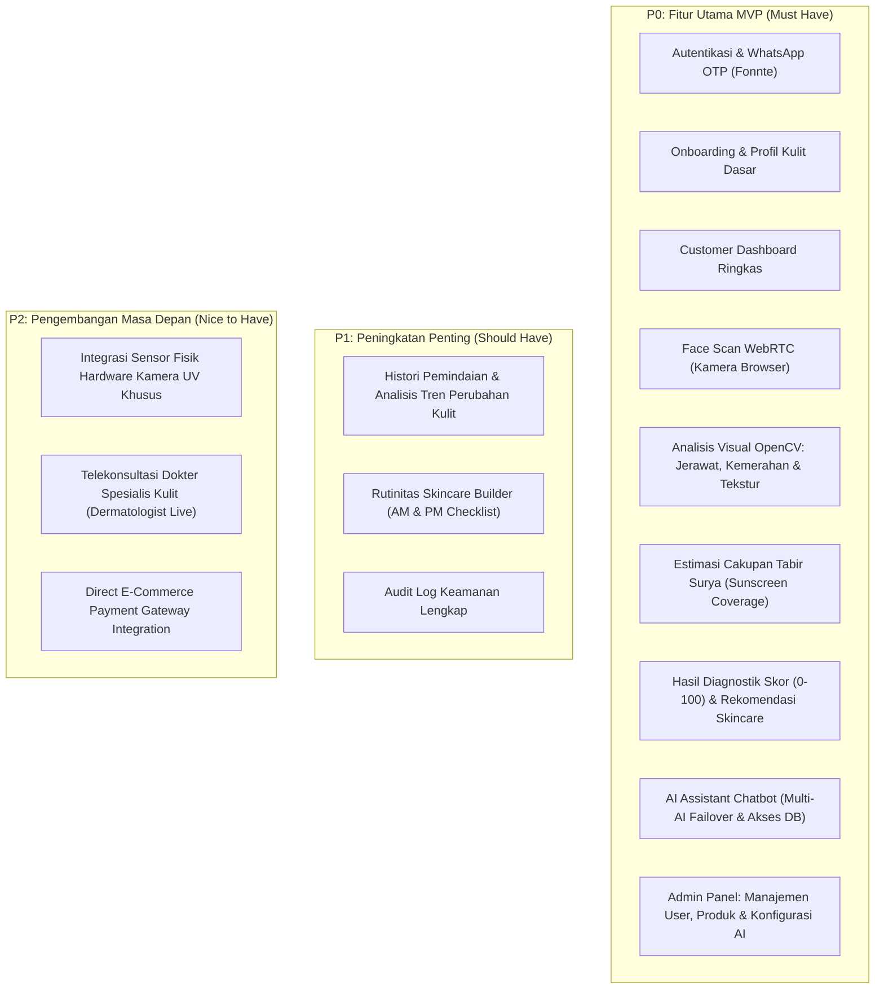
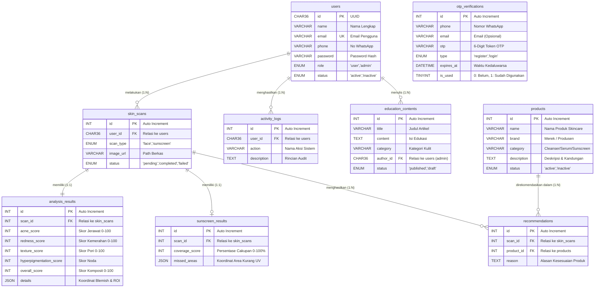

# 📄 PRODUCT REQUIREMENTS DOCUMENT (PRD) REVISI MVP
## SkinCheck — AI-Powered Skin Health Monitoring & Skincare Assistant

---

## 📌 METADATA DOKUMEN

| Parameter | Keterangan |
|---|---|
| **Nama Produk** | **SkinCheck (APSkincek)** |
| **Versi Dokumen** | **v1.2 (Revisi MVP Production)** |
| **Status Dokumen** | **Disetujui / Siap Implementasi & Pengujian** |
| **Klasifikasi Sistem** | Web-Based HealthTech & Computer Vision Platform |
| **Pola Arsitektur** | Model-View-Controller (MVC) + AI Microservice |
| **Basis Data** | Relasional (MySQL / PostgreSQL - 9 Tabel Ternormalisasi) |
| **Target Pengguna** | Customer (Masyarakat Umum / Pengguna Skincare) & Administrator |

---

## 1. 🎯 RINGKASAN EKSEKUTIF & LATAR BELAKANG

### 1.1 Visi Produk
Menjadi asisten pemantau kesehatan kulit wajah harian dan panduan tabir surya (*sunscreen*) berbasis Artificial Intelligence terpercaya bagi masyarakat Indonesia, menjembatani evaluasi visual biologis kulit dengan pemilihan produk perawatan yang terpersonalisasi, ilmiah, dan aman.

### 1.2 Latar Belakang Masalah (Problem Statement)
1. **Kesulitan Mengukur Kondisi Kulit Secara Objektif:** Sebagian besar pengguna skincare kesulitan mengetahui apakah kondisi kulit mereka membaik atau memburuk tanpa alat bantu klinis yang mahal.
2. **Penggunaan Tabir Surya yang Tidak Merata (*Uneven Sunscreen Application*):** Mayoritas kerusakan kulit akibat sinar ultraviolet (UV) terjadi karena pemakaian tabir surya yang tidak merata atau melewatkan area rentan (seperti cuping hidung dan sekitar mata).
3. **Ketergantungan pada Produk yang Tidak Sesuai (*Skincare Mismatch*):** Konsumen sering membeli produk berdasarkan tren media sosial yang berpotensi memicu peradangan kulit (*breakout*).
4. **Chatbot AI Konvensional Sering Berhalusinasi:** Banyak chatbot AI mengarang produk fiktif atau memberikan diagnosis medis yang berbahaya tanpa kendali batasan dermatologis.

### 1.3 Nilai Keunggulan (Value Proposition)
- **Non-Invasive Computer Vision Analysis:** Evaluasi instan terhadap lesi jerawat, indeks kemerahan (*erythema*), kehalusan tekstur pori, dan estimasi cakupan tabir surya hanya melalui kamera browser standar.
- **Rekomendasi Skincare Terikat Katalog (Anti-Halusinasi):** Algoritma rekomendasi dan chatbot hanya diperbolehkan merekomendasikan produk aktif yang terdaftar di basis data resmi.
- **Multi-LLM Auto-Failover Uptime 99.9%:** Chatbot asisten ditenagai perutean multi-kunci (Groq Cloud, Google Gemini 3.5, DeepSeek, OpenAI) dengan perpindahan otomatis instan saat limit kuota atau error status HTTP 402/429 tercapai.
- **Autentikasi Aman Berbasis WhatsApp OTP:** Registrasi dan login terlindungi verifikasi token 6 digit melalui Fonnte Gateway.

---

## 2. 👥 PENGGUNA SASARAN & PERSONA

### Persona 1: Customer (Pengguna Umum)
- **Karakteristik:** Individu berusia 17–40 tahun yang aktif merawat kulit wajah sehari-hari.
- **Kebutuhan:**
  - Mengetahui skor kesehatan kulit wajah secara rutin tanpa biaya konsultasi klinik yang tinggi.
  - Mengetahui apakah pemakaian tabir surya sudah merata sebelum terpapar sinar matahari.
  - Mendapatkan panduan rutinitas skincare (AM/PM) dan produk yang benar-benar cocok dengan kondisi kulit.
  - Konsultasi interaktif dengan asisten cerdas yang ramah dan berbasis data faktual.

### Persona 2: Administrator Sistem
- **Karakteristik:** Tim teknis dan pengelola operasional platform SkinCheck.
- **Kebutuhan:**
  - Memantau metrik performa sistem (total pengguna, riwayat scan, status akun).
  - Mengelola master katalog produk perawatan kulit dan konten edukasi.
  - Mengonfigurasi Kunci Utama dan Kunci Cadangan Multi-AI tanpa perlu merestart server secara manual.
  - Mengaudit jejak aktivitas keamanan (*activity logs*) sistem.

---

## 3. ⚖️ RUANG LINGKUP & PRIORITAS FITUR (P0, P1, P2)

---

## 4. 📋 SPESIFIKASI KEBUTUHAN FUNGSIONAL (FUNCTIONAL REQUIREMENTS)

### Modul 1: Autentikasi & Otorisasi Pengguna (P0)
- **FR-1.1:** Sistem wajib mendukung pendaftaran akun baru menggunakan Nama, Alamat Email, Nomor WhatsApp (+62), dan Kata Sandi.
- **FR-1.2:** Sistem wajib mengamankan kata sandi menggunakan fungsi hashing kriptografi aman (`bcrypt` / `password_hash`). Dilarang menyimpan password dalam bentuk teks polos (*plaintext*).
- **FR-1.3:** Saat registrasi, sistem membangkitkan 6 digit angka OTP token unik dengan masa berlaku 5 menit dan mengirimkannya ke WhatsApp pengguna melalui Fonnte API Gateway.
- **FR-1.4:** Sistem wajib menerapkan *Role-Based Access Control* (RBAC) ketat:
  - Role `user` (Customer): Hanya berhak mengakses dashboard pengguna, kamera scan, riwayat pribadi, dan chatbot.
  - Role `admin` (Administrator): Berhak mengakses seluruh menu manajerial dan konfigurasi API key.
- **FR-1.5:** Akun dengan status `inactive` diblokir dari seluruh proses login.

### Modul 2: Onboarding & Personalisasi Profil (P0)
- **FR-2.1:** Pengguna baru diarahkan ke halaman onboarding untuk mengisi preferensi biologis: jenis kulit (Berminyak, Kering, Kombinasi, Normal, Sensitif), keluhan utama (Jerawat, Kemerahan, Pori Besar, Hiperpigmentasi, Penuaan), dan kebiasaan pemakaian tabir surya.
- **FR-2.2:** Pengguna dapat memperbarui data preferensi ini sewaktu-waktu melalui menu Pengaturan Profil.

### Modul 3: Customer Dashboard (P0)
- **FR-3.1:** Menyajikan ringkasan kartu skor kesehatan kulit (*Overall Health Score 0-100*) dari hasil pemindaian terakhir.
- **FR-3.2:** Menyediakan tombol aksi cepat (*Quick Action*): "Scan Wajah", "Scan Sunscreen", dan "Konsultasi Chatbot AI".
- **FR-3.3:** Menampilkan rekomendasi rutinitas skincare harian (AM/PM).
- **FR-3.4:** Jika pengguna belum pernah melakukan pemindaian, dashboard menampilkan status awal (*empty state*) yang edukatif.

### Modul 4: Modul Kamera & Pengambilan Citra (WebRTC) (P0)
- **FR-4.1:** Menggunakan antarmuka kamera HTML5 MediaDevices API (`navigator.mediaDevices.getUserMedia`) dengan pratinjau langsung di layar.
- **FR-4.2:** Menyediakan bingkai panduan oval wajah (*face guide silhouette*) dan animasi laser pemindai (*scanning beam*).
- **FR-4.3:** Mengambil tangkapan gambar resolusi tinggi melalui Canvas API dan memvalidasi tipe file (`image/jpeg`, `image/png`) serta batas ukuran berkas (maksimal 5 MB).
- **FR-4.4:** Berkas foto disimpan di server dengan enkripsi nama unik (`uploads/scans/`) dan diisolasi dari akses publik ilegal.

### Modul 5: Pipeline AI Computer Vision (Skin Analysis) (P0)
- **FR-5.1:** Eksekusi skrip Python `analyze.py` menggunakan pustaka OpenCV dan NumPy secara non-blocking melalui subprocess.
- **FR-5.2 (Deteksi Wajah):** Menggunakan Haar Feature-based Cascade Classifier untuk mendeteksi wajah. Jika wajah tidak terdeteksi, kembalikan status error: *"Wajah tidak terdeteksi jelas, silakan foto ulang di ruangan terang"*.
- **FR-5.3 (Deteksi Jerawat):** Segmentasi ruang warna HSV dan YCrCb dikombinasikan dengan adaptive thresholding untuk mendeteksi papula dan lesi peradangan.
- **FR-5.4 (Deteksi Kemerahan / Eritema):** Menghitung nilai kromatisitas kanal $a^*$ pada ruang warna CIELAB ($L^*a^*b^*$) untuk mengukur derajat inflamasi pembuluh darah mikroskopis.
- **FR-5.5 (Analisis Tekstur & Pori):** Menghitung operator varians Laplace ($\nabla^2 f$) untuk mengevaluasi kehalusan vs kekasaran permukaan kulit.
- **FR-5.6 (Kalkulasi Skor):** Menghasilkan 4 sub-skor (Acne Score, Redness Score, Texture Score, Hyperpigmentation Score) dan nilai komposit akhir **Overall Health Score (0–100)** dalam format terstruktur JSON.

### Modul 6: Deteksi Pemerataan Tabir Surya (Sunscreen Coverage) (P0)
- **FR-6.1:** Eksekusi skrip Python `sunscreen_analyze.py` untuk mengestimasi cakupan perlindungan tabir surya pada wajah.
- **FR-6.2:** Menghitung rasio cakupan (*Coverage Score 0–100%*).
- **FR-6.3:** Menghasilkan koordinat area yang belum terlindungi (*missed areas*) dalam bentuk JSON heatmap untuk ditandai pada antarmuka pengguna.
- **FR-6.4 (Batasan Transparansi):** Antarmuka wajib mencantumkan disclaimer jelas bahwa kamera RGB biasa menghasilkan *estimasi visual*, bukan pengukuran sensor UV klinis laboratorium.

### Modul 7: Rekomendasi Produk Skincare Terikat Katalog (P0)
- **FR-7.1:** Backend mencocokkan skor diagnostik pengguna dengan atribut target produk (`skin_concern`, `category`) yang ada di tabel `products`.
- **FR-7.2:** Hanya produk berstatus `active` di basis data yang dapat direkomendasikan. Dilarang keras merekomendasikan produk fiktif atau yang tidak terdaftar.
- **FR-7.3:** Menyimpan relasi produk terpilih dan alasan klinis pencocokan ke dalam tabel `recommendations`.

### Modul 8: Asisten Chatbot AI & Multi-AI Failover (P0)
- **FR-8.1:** Menyediakan endpoint `/api/chat` berbasis server Node.js Express (port 3000) yang terhubung ke basis data MySQL `skincheck_db`.
- **FR-8.2 (Integrasi Database Cerdas):** Saat pengguna menanyakan data sistem (misal: jumlah customer atau riwayat scan), server mengeksekusi kueri agregat aman dan menyisipkan hasilnya sebagai konteks sistem.
- **FR-8.3 (Aturan Privasi & Jawaban Bertahap):**
  - Jika ditanya *"ada berapa customer?"*, chatbot **hanya menjawab total jumlahnya saja** (misal: *"Saat ini terdapat 5 customer yang terdaftar..."*).
  - Hanya jika pengguna bertanya *"siapa saja customer nya?"*, barulah chatbot merinci daftar nama customer secara sopan tanpa tanda kurung.
- **FR-8.4 (Arsitektur Multi-AI Failover):**
  - Kunci Utama (*Primary API Key*): Groq Cloud / Google Gemini.
  - Hingga 3 Kunci Cadangan (*Standby Multi-AI*): DeepSeek, OpenAI, Groq, Gemini.
  - Jika terjadi status HTTP 401, 402 (*Insufficient Balance*), 404, atau 429 (*Rate Limit*), router otomatis mengalihkan *payload* ke kunci cadangan dalam waktu < 300 ms tanpa disadari oleh pengguna.

### Modul 9: Panel Administrator (Admin Dashboard) (P0)
- **FR-9.1:** Menyajikan kartu metrik utama: Total Customer Terdaftar, Total Administrator, Total Scan Kulit (Wajah & Sunscreen).
- **FR-9.2:** Manajemen Pengguna: Melihat tabel daftar akun customer dan admin, status aktif/nonaktif, serta total pemindaian.
- **FR-9.3:** Manajemen Katalog Produk: CRUD (Tambah, Edit, Hapus/Nonaktifkan) produk perawatan kulit.
- **FR-9.4:** Panel Konfigurasi Multi-API Key: Mengubah kunci utama, memilih model AI aktif, mengatur kunci cadangan, dan tombol *"Uji Coba Latensi API Key"* secara langsung.

### Modul 10: Scan History & Progress Tracking (P1)
- **FR-10.1:** Pengguna dapat melihat linimasa riwayat pemindaian terdahulu, membandingkan foto awal (*baseline*) dengan kondisi terkini, serta melihat grafik tren peningkatan skor kesehatan kulit.

---

## 5. 🛡️ SAFETY GUARDRAILS & MEDICAL DISCLAIMER

Sistem SkinCheck mematuhi regulasi ketat aplikasi kesehatan digital:
1. **Bukan Pengganti Dokter Spesialis:** Seluruh hasil komputasi dan saran chatbot wajib diberi label sebagai *indikasi dan analisis visual perawatan kulit*, bukan diagnosis penyakit kulit klinis.
2. **Larangan Resep Obat Keras:** AI dilarang merekomendasikan obat keras dengan resep dokter (seperti Isotretinoin oral, Tretinoin konsentrasi tinggi, atau antibiotik oral).
3. **Peringatan Gejala Berbahaya (*Red Flag Routing*):** Jika sistem mendeteksi keluhan luka terbuka bernanah, tahi lalat asimetris berdarah (indikasi keganasan melanoma), atau infeksi herpes, sistem wajib menampilkan pesan waspada berwarna merah dan menganjurkan konsultasi langsung ke Dokter Spesialis Kulit dan Kelamin (Sp.KK / Sp.DVE).

---

## 6. ⚙️ SPESIFIKASI KEBUTUHAN NON-FUNGSIONAL (NON-FUNCTIONAL REQUIREMENTS)

| Kategori | Parameter | Spesifikasi & Batasan |
|---|---|---|
| **Keamanan** | Hashing Kata Sandi | Wajib menggunakan algoritma `bcrypt` (cost factor 10+) atau Argon2. |
| **Keamanan** | Injeksi SQL & XSS | Wajib menggunakan PDO Prepared Statements pada backend PHP & MySQL pool parameterization pada Node.js. Sanitasi `htmlspecialchars()` pada output view. |
| **Keamanan** | Keamanan Berkas Foto | File foto scan disimpan di folder non-public, nama file diacak dengan UUID / hash, akses langsung URL divalidasi otorisasi sesi. |
| **Performa** | Waktu Analisis Citra | Pemrosesan Computer Vision Python tidak boleh melebihi **3,0 detik** per gambar. |
| **Performa** | Waktu Respon Chatbot | Respon pertama chatbot tidak boleh melebihi **2,0 detik** (Groq latensi 150-300ms, Gemini latensi 400-800ms). |
| **Keandalan** | Auto-Failover Switching | Waktu perpindahan dari kunci utama yang gagal ke kunci cadangan di bawah **300 milidetik**. |
| **Keandalan** | Tingkat Ketersediaan (*Uptime*) | Target uptime layanan chatbot dan web adalah **99,9%**. |
| **Responsivitas UI**| Kompatibilitas Perangkat | Layout antarmuka responsif sempurna di perangkat Mobile (360px+), Tablet (768px+), dan Desktop (1080p+). |

---

## 7. 🗄️ STRUKTUR ENTITAS BASIS DATA (9 TABEL RELASIONAL)

---

## 8. 🧪 KRITERIA PENERIMAAN (ACCEPTANCE CRITERIA) & TESTING

| No | Modul | Kondisi Pengujian | Hasil yang Diharapkan (Acceptance Criteria) |
|---|---|---|---|
| 1 | **Registrasi** | Input formulir valid & nomor WhatsApp | Kode token OTP 6 digit diterima di ponsel WhatsApp via Fonnte dalam waktu < 10 detik. |
| 2 | **Validasi OTP** | Input kode token benar sebelum 5 menit | Akun status aktif dibuat di basis data, sesi terinisialisasi, dialihkan ke onboarding/dashboard. |
| 3 | **Validasi OTP** | Input kode salah / kedaluwarsa | Muncul notifikasi error jelas, akun tidak diaktifkan. |
| 4 | **Face Scan** | Pengguna mengizinkan akses kamera | Pratinjau video WebRTC tampil halus dengan garis laser pemindai. |
| 5 | **Face Scan** | Wajah tidak terlihat jelas / tertutup | Skrip Python mengembalikan status `failed` dan sistem menyarankan foto ulang. |
| 6 | **Skin Analysis** | Wajah terdeteksi jelas | Skor 0–100 untuk Acne, Redness, Tekstur, dan Overall Score tersimpan di tabel `analysis_results`. |
| 7 | **Rekomendasi** | Analisis selesai | Menampilkan daftar produk yang berstatus `active` yang cocok dengan kebutuhan kulit pengguna. |
| 8 | **Chatbot DB** | Bertanya: *"ada berapa customer?"* | Chatbot **hanya menyebutkan angka total 5 customer** tanpa menyebutkan nama. |
| 9 | **Chatbot DB** | Bertanya: *"siapa saja customer nya?"* | Chatbot menyebutkan rincian 5 nama customer dari database tanpa tanda kurung. |
| 10 | **Auto-Failover**| Primary key habis kuota (HTTP 402) | Sistem otomatis mengalihkan request ke Backup Key 1 (Gemini 3.5) dan menjawab dalam < 1 detik. |
| 11 | **Keamanan Role**| Akun role customer mengakses `/admin` | Sistem menolak akses (HTTP 403 / redirect) ke dashboard customer. |

---

## 9. 🚀 JALUR PENGEMBANGAN (ROADMAP)

1. **Sprint 1 (Fondasi & Autentikasi):** Inisialisasi arsitektur MVC, basis data 9 tabel, registrasi & WhatsApp OTP Fonnte.
2. **Sprint 2 (Computer Vision & Kamera):** Implementasi WebRTC camera scanner, skrip OpenCV `analyze.py` & `sunscreen_analyze.py`.
3. **Sprint 3 (Chatbot & Failover):** Microservice Node.js Express, kueri aman database MySQL, sistem multi-AI failover.
4. **Sprint 4 (Panel Admin & Polish):** Dashboard metrik admin, CRUD produk & edukasi, pengujian end-to-end MVP.
